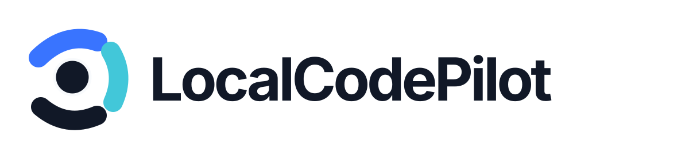

# LocalCodePilot

<p align="center">
  
</p>

> Clique em **Iniciar** e o projeto sobe. Sem decorar comandos, sem procurar porta, sem abrir terminal.
>
> Click **Start** and your project is up. No commands to remember, no ports to hunt, no terminal to open.

**Alpha pública / public alpha.** O LocalCodePilot ainda está em desenvolvimento e pode mudar antes da versão estável.

[Português](#português) · [English](#english)

---

## Português

### O que é

O LocalCodePilot é um aplicativo para desenvolvedores, do júnior ao especialista, que encontra os projetos do seu computador e cuida de rodá-los por você:

- **Encontra seus projetos sozinho** e reconhece a linguagem e o framework de cada um.
- **Prepara o que falta:** instala as dependências do projeto e, quando a linguagem nem está instalada, oferece instalá-la com um clique.
- **Inicia, mostra o endereço e abre o site.** Se algo der errado (uma porta ocupada, um programa que fechou), diz o motivo em português e oferece **Tentar de novo**.
- **Também cuida de containers** (Docker e Podman), com proteção para um projeto não mexer nos containers de outro.

Tudo roda no seu computador. O app não envia seus projetos para lugar nenhum, e nada é instalado sem você ver o plano e confirmar.

### Baixar e instalar

**Windows 10/11 (64 bits).** Na página de [releases](https://github.com/cjulio1993/LocalCodePilot/releases):

- **Instalador (`LocalCodePilotSetup-<versão>-windows-x64.exe`; até a alpha 8, `...-windows-x64-setup.exe`), recomendado.** Instala o app e cria o atalho no Menu Iniciar. O outro `.exe` da release (`LocalCodePilot-<versão>-windows-x64.exe`) é o arquivo que o app usa para se atualizar.
- **Zip (portátil).** Extraia e execute `LocalCodePilot.exe`, sem instalar.

Os arquivos desta versão ainda não têm assinatura digital, por isso o Windows pode mostrar "O Windows protegeu o computador". Clique em **Mais informações** e depois em **Executar assim mesmo**. Se quiser conferir o arquivo, compare o SHA-256 publicado na release. A assinatura digital está a caminho.

**macOS (experimental).** Há um pacote universal (Intel e Apple Silicon) para testes; a validação em Mac real ainda está em andamento. Veja [docs/README-MACOS.txt](docs/README-MACOS.txt).

### Primeiros passos

1. **Abra o app.** Em **Projetos**, ele mostra o que encontrou nas pastas comuns do computador. Use **Adicionar pasta** se seus projetos estiverem em outro lugar. A busca não entra em pastas de programas instalados (como `Program Files` e `%LOCALAPPDATA%\Programs`), a não ser que você adicione uma delas.
2. **Escolha um projeto.** O cartão mostra o que ele precisa e qual é o próximo passo:
   - **Preparar ambiente**, quando falta a linguagem;
   - **Instalar dependências**, quando faltam as bibliotecas do projeto;
   - **Iniciar**, quando está tudo pronto.

   Se dois projetos têm o mesmo nome, o cartão mostra também o trecho da pasta que os diferencia.
3. **Clique no botão.** O app mostra o que vai fazer e só executa depois da sua confirmação. Nas ações de containers, a confirmação mostra a pasta e o motor (Docker ou Podman).
4. **Use o projeto.** Quando o site responde, o cartão mostra o endereço e **Abrir site**. **Ver logs** mostra a saída do programa, e **Parar** encerra tudo o que o projeto abriu.

A página **Ajuda**, dentro do app, explica cada estado e o que fazer em cada caso.

### Linguagens e projetos

O que acontece ao clicar em **Iniciar**, validado no Windows 11:

| Projeto | O app inicia com | O app prepara |
| --- | --- | --- |
| Node.js / JavaScript (npm, pnpm, Yarn, Bun) | o script de desenvolvimento (`dev`, `start`…) | as dependências |
| PHP, Laravel, Lumen | o servidor do PHP ou `artisan serve` | o Composer, o `.env` e a chave do Laravel |
| Python, Flask, Django | o `app.py`/`main.py` ou `runserver` | o ambiente virtual e as dependências |
| Java e Kotlin (Maven, Gradle, Spring Boot, Ktor) | o wrapper do projeto (`mvnw`, `gradlew`) | o próprio Gradle/Maven baixa as dependências |
| .NET (ASP.NET, Blazor, console) | `dotnet run` | o `dotnet` restaura os pacotes |
| Ruby (Rails, Rack, Sinatra) | `bin/rails server`, `rackup` ou `ruby app.rb` | `bundle install` dentro do projeto |
| Go | `go run` | o Go baixa os módulos |
| Rust | `cargo run` | o Cargo baixa as dependências |
| Dart e Flutter (web e Windows) | `dart run` ou `flutter run` | as dependências do `pub` |
| Deno | as tarefas do `deno.json` | o Deno baixa as dependências |
| Elixir (Phoenix) | `mix phx.server` | Hex, Rebar e `mix deps.get` |
| Swift | `swift run` | o ambiente do Visual Studio no Windows (precisa do Build Tools com C++) |
| Scala (sbt, Play) | `sbt run` | o sbt baixa as dependências |
| Clojure (`deps.edn`) | `bb clojure -M:run` | **instala o Babashka** se faltar |
| Haskell (Stack) | `stack run` | **instala o Stack**, baixa o compilador e compila |
| Zig | `zig build run` | **instala o Zig** se faltar |
| Sites HTML e projetos sem framework | um servidor local (ou `java Main.java`, ou o servidor do PHP) | — |
| Containers (Docker, Podman, Compose) | `compose up`, escolhendo o motor | não instala o Docker/Podman; mostra o passo a passo |
| Outras linguagens (C/C++, Perl, Lua, R, Julia…) | o comando que você definir uma vez | — |

Quando uma linguagem não está instalada, **Preparar ambiente** usa o `winget` do Windows. Nas linhas em negrito, a instalação foi validada de ponta a ponta. Para Python, Java, PHP, Node.js, Go e Dart, a instalação pelo app ainda está em validação.

### Limitações desta alpha

- **Plataforma:** a validação de ponta a ponta foi feita no Windows 11. No macOS o pacote é experimental, e no Linux há só testes automáticos.
- **Assinatura:** os downloads ainda não têm assinatura digital (veja [Baixar e instalar](#baixar-e-instalar)).
- **Bancos de dados:** projetos que precisam de banco (Rails com `db:prepare`, Phoenix com Ecto) ainda pedem esse passo manual. O erro aparece em **Ver logs**.
- **Formatos não cobertos:** Leiningen (`project.clj`) e Haskell só com Cabal ainda pedem o comando de início.
- **Containers:** o app não instala o Docker nem o Podman.
- **Atualização pelo app:** é experimental até ser testada com uma versão mais nova. Durante a atualização, o app mostra as etapas Baixar, Verificar e Reiniciar e a barra do download.

### Para desenvolvedores

O LocalCodePilot é escrito em Rust: um app desktop (`egui`) e uma CLI sobre o mesmo núcleo. Para compilar, você precisa do [rustup](https://rustup.rs/).

```powershell
cargo run                                   # abre o app desktop
cargo run -p localcodepilot-cli -- scan     # lista os projetos pela CLI
cargo test --workspace                      # testes
cargo clippy --workspace --all-targets -- -D warnings
```

- **Como o app decide as coisas** (classificação, comandos, portas, containers, preparação do ambiente e atualização): [docs/DETALHES-TECNICOS.md](docs/DETALHES-TECNICOS.md).
- **Containers e conflitos de nome do Compose:** [docs/CONTAINERS.md](docs/CONTAINERS.md).
- **Bancos de dados:** [docs/DATABASES.md](docs/DATABASES.md).
- **Histórico de versões:** [CHANGELOG.md](CHANGELOG.md).
- **Contribuição:** antes de uma mudança grande, abra uma issue. Toda mudança de comportamento atualiza este README, o CHANGELOG e a Ajuda do app.

---

## English

### What it is

LocalCodePilot is an app for developers, from junior to expert, that finds the projects on your computer and takes care of running them for you:

- **Finds your projects on its own** and recognizes each one's language and framework.
- **Prepares what is missing:** installs the project's dependencies and, when the language itself is not installed, offers to install it with one click.
- **Starts the project, shows its address, and opens the site.** When something goes wrong (a port in use, a program that closed), it tells you why and offers **Try again**.
- **Also handles containers** (Docker and Podman), with protection so one project does not touch another project's containers.

Everything runs on your computer. The app does not send your projects anywhere, and nothing is installed before you see the plan and confirm it.

### Download and install

**Windows 10/11 (64-bit).** On the [releases](https://github.com/cjulio1993/LocalCodePilot/releases) page:

- **Installer (`LocalCodePilotSetup-<version>-windows-x64.exe`; up to alpha 8, `...-windows-x64-setup.exe`), recommended.** Installs the app and adds a Start menu shortcut. The other `.exe` on the release (`LocalCodePilot-<version>-windows-x64.exe`) is the file the app uses to update itself.
- **Zip (portable).** Extract it and run `LocalCodePilot.exe`, no install needed.

The files in this version are not digitally signed yet, so Windows may show "Windows protected your PC". Click **More info** and then **Run anyway**. To check the file, compare the SHA-256 published on the release. Digital signing is on its way.

**macOS (experimental).** A universal package (Intel and Apple Silicon) is available for testing; validation on a real Mac is still in progress. See [docs/README-MACOS.txt](docs/README-MACOS.txt).

### Getting started

1. **Open the app.** **Projects** lists what it found in the usual folders. Use **Add folder** if your projects live elsewhere. The search does not go into folders of installed programs (such as `Program Files` and `%LOCALAPPDATA%\Programs`) unless you add one yourself.
2. **Pick a project.** Its card shows what it needs and the next step:
   - **Prepare environment** when the language is missing;
   - **Install dependencies** when the project's libraries are missing;
   - **Start** when everything is ready.

   When two projects share a name, the card also shows the part of the folder that tells them apart.
3. **Click the button.** The app shows what it will do and runs only after you confirm. For container actions, the confirmation shows the folder and the engine (Docker or Podman).
4. **Use the project.** When the site answers, the card shows its address and **Open site**. **View logs** shows the program's output, and **Stop** ends everything the project opened.

The **Help** page inside the app explains each state and what to do.

### Languages and projects

What happens when you click **Start**, validated on Windows 11:

| Project | The app starts it with | The app prepares |
| --- | --- | --- |
| Node.js / JavaScript (npm, pnpm, Yarn, Bun) | the development script (`dev`, `start`…) | the dependencies |
| PHP, Laravel, Lumen | PHP's server or `artisan serve` | Composer, `.env`, and the Laravel key |
| Python, Flask, Django | `app.py`/`main.py` or `runserver` | the virtual environment and dependencies |
| Java and Kotlin (Maven, Gradle, Spring Boot, Ktor) | the project's wrapper (`mvnw`, `gradlew`) | Gradle/Maven download the dependencies |
| .NET (ASP.NET, Blazor, console) | `dotnet run` | `dotnet` restores the packages |
| Ruby (Rails, Rack, Sinatra) | `bin/rails server`, `rackup`, or `ruby app.rb` | `bundle install` inside the project |
| Go | `go run` | Go downloads the modules |
| Rust | `cargo run` | Cargo downloads the dependencies |
| Dart and Flutter (web and Windows) | `dart run` or `flutter run` | the `pub` dependencies |
| Deno | the `deno.json` tasks | Deno downloads the dependencies |
| Elixir (Phoenix) | `mix phx.server` | Hex, Rebar, and `mix deps.get` |
| Swift | `swift run` | the Visual Studio environment on Windows (needs Build Tools with C++) |
| Scala (sbt, Play) | `sbt run` | sbt downloads the dependencies |
| Clojure (`deps.edn`) | `bb clojure -M:run` | **installs Babashka** if missing |
| Haskell (Stack) | `stack run` | **installs Stack**, downloads the compiler, and builds |
| Zig | `zig build run` | **installs Zig** if missing |
| HTML sites and projects without a framework | a local server (or `java Main.java`, or PHP's server) | — |
| Containers (Docker, Podman, Compose) | `compose up`, with your choice of engine | does not install Docker/Podman; shows the steps |
| Other languages (C/C++, Perl, Lua, R, Julia…) | the command you define once | — |

When a language is not installed, **Prepare environment** uses Windows' `winget`. Installation was validated end to end for the rows in bold. For Python, Java, PHP, Node.js, Go, and Dart, installation by the app is still being validated.

### Limitations in this alpha

- **Platform:** end-to-end validation was done on Windows 11. The macOS package is experimental, and Linux has automated tests only.
- **Signing:** downloads are not digitally signed yet (see [Download and install](#download-and-install)).
- **Databases:** projects that need a database (Rails with `db:prepare`, Phoenix with Ecto) still need that manual step. The error shows in **View logs**.
- **Formats not covered:** Leiningen (`project.clj`) and Cabal-only Haskell projects still ask for the start command.
- **Containers:** the app does not install Docker or Podman.
- **In-app update:** experimental until tested against a newer release. While updating, the app shows the download, verify, and restart steps and a download progress bar.

### For developers

LocalCodePilot is written in Rust: a desktop app (`egui`) and a CLI on the same core. To build it, you need [rustup](https://rustup.rs/).

```powershell
cargo run                                   # opens the desktop app
cargo run -p localcodepilot-cli -- scan     # lists projects from the CLI
cargo test --workspace                      # tests
cargo clippy --workspace --all-targets -- -D warnings
```

- **How the app decides** (classification, commands, ports, containers, environment setup, and updates): [docs/DETALHES-TECNICOS.md](docs/DETALHES-TECNICOS.md).
- **Containers and Compose name conflicts:** [docs/CONTAINERS.md](docs/CONTAINERS.md).
- **Databases:** [docs/DATABASES.md](docs/DATABASES.md).
- **Release history:** [CHANGELOG.md](CHANGELOG.md).
- **Contributing:** before a large change, open an issue. Every behavior change updates this README, the CHANGELOG, and the in-app Help.

## License

MIT. See [LICENSE](LICENSE).
